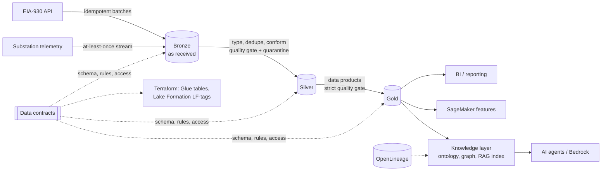

# gridlake: an AI-ready energy grid lakehouse

[](https://github.com/taojian-feng/data_pipeline/actions/workflows/ci.yml)


A production-grade data pipeline that turns raw US power-grid data (EIA-930 hourly operations
and streaming substation telemetry) into governed data products for BI, ML and AI agents.
It covers ingestion, an Iceberg medallion lakehouse, contract-driven quality gates, OpenLineage
lineage, a knowledge layer (ontology, knowledge graph, access-aware RAG retrieval), and a
**grid analyst agent** that answers questions by choosing its own tools and cites the tables it used.

**It runs end to end on a laptop in about 10 seconds with no cloud account**, and the same code
deploys to AWS (S3 Tables / Glue Data Catalog, Lake Formation, Kinesis, Lambda, Glue Spark,
Step Functions, Bedrock Knowledge Bases, Bedrock Agents, Athena) through the Terraform in [`infra/terraform`](infra/terraform).

```bash
make install && make demo        # or: pip install -e ".[dev]" && gridlake run
```

---

## What it demonstrates

| Capability | Where |
|---|---|
| **Lakehouse on Apache Iceberg**: medallion layers, MERGE upserts, dynamic partition overwrite, snapshots, partition evolution | [`catalog.py`](src/gridlake/catalog.py), [ADR 0001](docs/adr/0001-iceberg-everywhere.md) |
| **Same code, three catalogs**: local SQL catalog, AWS Glue Data Catalog, Amazon S3 Tables (Iceberg REST, SigV4) | [`catalog.py`](src/gridlake/catalog.py) |
| **Batch ingestion**: paginated, retrying EIA API v2 client; content-addressed idempotent landing | [`sources/eia.py`](src/gridlake/sources/eia.py), [`ingest/batch.py`](src/gridlake/ingest/batch.py) |
| **Streaming**: at-least-once consumer, commit-after-write checkpoints, per-partition event-time watermarks, exactly-once results | [`ingest/stream.py`](src/gridlake/ingest/stream.py), [`aws_lambda.py`](src/gridlake/aws_lambda.py), [ADR 0004](docs/adr/0004-at-least-once-exactly-once.md) |
| **Incremental processing**: high-water marks, restatement-safe recompute of touched keys, affected-date gold rebuilds | [`pipeline.py`](src/gridlake/pipeline.py), [`transform/`](src/gridlake/transform) |
| **Data contracts** as the control plane for schema, ownership, classification, quality, catalog and access | [`contracts/`](contracts), [ADR 0002](docs/adr/0002-contracts-as-control-plane.md) |
| **Data quality**: declarative rules compiled to SQL, quarantine in silver, circuit breaker in gold, results history | [`quality/engine.py`](src/gridlake/quality/engine.py), [ADR 0003](docs/adr/0003-quarantine-vs-circuit-breaker.md) |
| **Lineage**: OpenLineage START/COMPLETE/FAIL events with schema, ownership, version and DQ facets | [`lineage.py`](src/gridlake/lineage.py) |
| **Data products for multiple consumers**: BI, sustainability reporting, leakage-free ML features, reliability engineering | [`transform/gold.py`](src/gridlake/transform/gold.py) |
| **Ontology + knowledge graph** joining grid topology with the data estate (datasets, columns, glossary, owners, lineage); OWL / Turtle / N-Triples for Neptune | [`knowledge/ontology.yaml`](src/gridlake/knowledge/ontology.yaml), [`knowledge/graph.py`](src/gridlake/knowledge/graph.py) |
| **RAG for agents**: clearance-filtered retrieval, metadata filters, GraphRAG context packs, Bedrock KB export | [`knowledge/retrieval.py`](src/gridlake/knowledge/retrieval.py), [`knowledge/context.py`](src/gridlake/knowledge/context.py), [ADR 0005](docs/adr/0005-ontology-guardrails-and-access-aware-retrieval.md) |
| **Grid analyst agent**: the model picks tools (SQL on gold, knowledge graph, document search, catalog) and cites tables; caller clearance is bound outside the model and enforced in every tool, then again by Lake Formation; runs offline or on Claude via Amazon Bedrock, or as a Bedrock Agent | [`agent/`](src/gridlake/agent), [`agent.tf`](infra/terraform/agent.tf), [ADR 0005](docs/adr/0005-ontology-guardrails-and-access-aware-retrieval.md) |
| **Least-privilege governance**: Lake Formation tag-based access control generated from contracts, KMS, TLS-only buckets | [`governance.tf`](infra/terraform/governance.tf), [`iam.tf`](infra/terraform/iam.tf) |
| **Operations**: Step Functions with retries and alerts, DLQ, iterator-age alarms, nightly Iceberg maintenance, runbook | [`orchestration.tf`](infra/terraform/orchestration.tf), [`monitoring.tf`](infra/terraform/monitoring.tf), [runbook](docs/runbook.md) |
| **Validating AI-assisted code** in a regulated setting | [docs/ai-assisted-delivery.md](docs/ai-assisted-delivery.md) |

## Architecture



Details, the AWS deployment diagram and the local-vs-AWS mapping are in
[docs/architecture.md](docs/architecture.md).

### Tables

| Layer | Table | Grain | Classification |
|---|---|---|---|
| bronze | `eia_region_data`, `eia_fuel_type_data` | API record + batch metadata | internal |
| bronze | `grid_telemetry` | stream event (with duplicates) | confidential |
| silver | `dim_balancing_authority`, `dim_fuel_type` | entity | public |
| silver | `demand_hourly` | BA x hour | internal |
| silver | `generation_hourly` | BA x hour x energy source | internal |
| silver | `grid_telemetry_minute` | substation x minute (exactly-once) | confidential |
| gold | `ba_daily_energy` | BA x day: demand, peak, forecast MAPE, renewable share, carbon intensity | public |
| gold | `fuel_mix_daily` | BA x day x energy source | public |
| gold | `demand_forecast_features` | BA x hour, point-in-time-correct lags | internal |
| gold | `grid_reliability_daily` | BA x day frequency excursions | confidential |
| ops | `quality.results`, `quality.quarantine` | rule evaluation / rejected row | internal / confidential |

## Quickstart

```bash
python -m venv .venv && source .venv/bin/activate
pip install -e ".[dev]"

gridlake run --days 14            # full pipeline into ./.gridlake (Iceberg warehouse + catalog)
gridlake quality                  # rule outcomes and quarantined rows
gridlake lineage                  # dataset lineage from OpenLineage events
gridlake sql "SELECT * FROM gold_ba_daily_energy ORDER BY date DESC LIMIT 5"
gridlake ask "What was the renewable share for CAISO on 2026-10-20?" --trace   # grid analyst agent
pytest                            # 40+ tests including end-to-end idempotency and failure paths
```

Real EIA data: get a free key at <https://www.eia.gov/opendata/register.php> and
`export EIA_API_KEY=...`. Without a key the pipeline uses a deterministic synthetic replica of
EIA-930 that reproduces real feed defects (missing hours, malformed values, sign errors,
unregistered respondents, restatements, stream duplicates and late events).

Docker: `docker build -t gridlake . && docker run --rm -v gridlake:/data gridlake run --days 14`

### Sample output (synthetic data, 14 days, 8 balancing authorities)

```text
COMPLETE  seed_dimensions                 0.24s  {"dim_balancing_authority": {"rows": 8}, "dim_fuel_type": {"rows": 8}}
COMPLETE  ingest_eia                      1.03s  {"bronze.eia_region_data": {"rows": 10753}, "bronze.eia_fuel_type_data": {"rows": 16128}}
COMPLETE  ingest_stream                   1.15s  {"produced": 35241, "consumed": 35241, "micro_batches": 9, "late_events": 123}
COMPLETE  silver_demand_hourly            0.50s  {"rows": 2670, "quarantined": 19}
COMPLETE  silver_generation_hourly        3.85s  {"rows": 16009, "quarantined": 119}
COMPLETE  silver_grid_telemetry_minute    1.16s  {"rows": 8640, "quarantined": 0}
COMPLETE  gold_ba_daily_energy            0.17s  {"rows": 112, "quarantined": 0}
COMPLETE  gold_fuel_mix_daily             0.18s  {"rows": 672, "quarantined": 0}
COMPLETE  gold_demand_forecast_features   0.18s  {"rows": 2670, "warnings": ["not_null(demand_lag_24h)"]}
COMPLETE  gold_grid_reliability_daily     0.11s  {"rows": 8, "quarantined": 0}
COMPLETE  knowledge_layer                 0.16s  {"graph": {"triples": 977, ...}, "documents": 138}
```

```text
$ gridlake sql "SELECT ba_code, round(avg(renewable_share_pct),1) renewable_pct, round(avg(carbon_intensity_kg_per_mwh)) kg_co2_per_mwh FROM gold_ba_daily_energy GROUP BY 1 ORDER BY 2 DESC"
 ba_code  renewable_pct  kg_co2_per_mwh
 BPAT              90.6             9.0
 CISO              34.6           219.0
 SWPP              29.2           471.0
 NYIS              26.9           214.0
 ERCO              20.3           374.0
 ISNE              13.2           256.0
 MISO              11.4           528.0
 PJM                5.6           358.0

$ gridlake sql "SELECT failed_rules, count(*) n FROM quality_quarantine GROUP BY 1 ORDER BY 2 DESC"
 not_null(period,ba_code,fuel_type,generation_mwh,_updated_ts)   119
 not_null(demand_mwh)                                             15
 range(demand_mwh:0..250000)                                       3
 referential(ba_code->silver.dim_balancing_authority.ba_code)      1
```

### Grid analyst agent

`gridlake ask` runs a tool-using agent. The model decides which tools to call: `lookup_entity`
resolves "California ISO" to `CISO` through the knowledge graph, `run_sql` queries the gold
tables, `describe_table` names the owner and lineage, and `search_documents` retrieves passages.
Every answer lists the tables and documents it came from.

```text
$ gridlake ask "Which balancing authority had the highest renewable share, and which table should I use?" --clearance internal --trace
> lookup_entity({"text": "Which balancing authority had the highest renewable share, and which table should I use?"}) -> ok
> run_sql({"sql": "SELECT ba_code, min(date) AS first_day, max(date) AS last_day, round(avg(renewable_share_pct), 2) AS value FROM gold.ba_daily_energy GROUP BY ba_code ORDER BY value DESC LIMIT 10"}) -> ok
> describe_table({"table": "gold.ba_daily_energy"}) -> ok

BPAT ranks first by average renewable share (90.6%, 2026-10-10 to 2026-10-23). Ranking: 1. BPAT 90.6%; 2. CISO 34.6%; ...
The governed table is gold.ba_daily_energy (public, owned by grid-analytics@gridlake.example, contract v1.0.0),
derived from silver.demand_hourly, silver.dim_balancing_authority, silver.dim_fuel_type, silver.generation_hourly, ...

sources: tables=gold.ba_daily_energy; documents=knowledge-graph  [offline-planner, clearance=internal]

$ gridlake ask "Which balancing authority had the most frequency excursion minutes?" --trace
> lookup_entity(...) -> ok
> run_sql({"sql": "SELECT ba_code, ... FROM gold.grid_reliability_daily GROUP BY ba_code ..."}) -> error: access denied:
  gold.grid_reliability_daily is classified confidential; caller clearance is public
```

**Access is enforced outside the model.** The caller's clearance is bound when the toolbox is
built (from the CLI flag locally, from Bedrock Agent session attributes set by the calling app on
AWS). The model never sees a clearance parameter and cannot pass one. Each tool checks it:

| Tool | Enforcement |
|---|---|
| `run_sql` | DuckDB's parser lists every table the statement reads (through CTEs, joins and subqueries). Anything but one `SELECT`, any table function (`read_csv`, `read_parquet`) and any table above clearance is refused before the query runs. Locally only the checked tables are attached and file access is switched off; on Athena, Lake Formation grants the tools' role tables up to `analyst_agent_max_clearance` only. |
| `list_tables` | Lists only tables the caller may query. |
| `describe_table` | Catalog metadata (owner, lineage, rules) is never more open than `internal`. |
| `lookup_entity` | Graph facts touching a dataset, column or substation above clearance are dropped. |
| `search_documents` | Local index filters by clearance before ranking. On AWS, Bedrock `Retrieve` gets a `classification` metadata filter, and returned hits are checked again. |

**Models.** Without a cloud account the agent runs on `OfflinePlanner`, a deterministic,
rule-based stand-in (not an LLM) that covers metric lookups, rankings and catalog questions.
With AWS credentials, `pip install -e ".[agent]"` and `gridlake ask "..." --llm bedrock` runs the
same loop on Claude in Amazon Bedrock (`GRIDLAKE_AGENT_MODEL`, default `anthropic.claude-opus-5-5`).
Set `GRIDLAKE_AGENT_SQL=athena` and `GRIDLAKE_ATHENA_WORKGROUP` to query Athena instead of the local
lake, and `GRIDLAKE_BEDROCK_KB_ID` to search the Bedrock Knowledge Base.

`gridlake ask --context-only` still prints the GraphRAG context pack (linked entities, graph
facts and clearance-filtered passages) for use in another model's prompt.

## Guarantees backed by tests

| Guarantee | Test |
|---|---|
| Re-running the same window changes nothing (no new snapshots, no duplicate rows) | `test_rerun_is_idempotent` |
| Replayed stream events do not double count | `test_redelivered_stream_events_do_not_double_count` |
| An uncommitted micro-batch is replayed after a crash | `test_uncommitted_batch_is_replayed_after_crash` |
| EIA restatements flow through to gold without touching other partitions | `test_restatement_flows_through_to_gold` |
| A gold quality failure publishes nothing and emits a lineage FAIL event | `test_quality_gate_stops_publication` |
| ML features use only information available 24h before the target | `test_forecast_features_are_point_in_time_correct` |
| Step-by-step orchestration (as in Step Functions) equals a single run | `test_step_mode_matches_full_run` |
| Invalid relationships are rejected by the ontology | `test_ontology_guardrails_reject_invalid_triples` |
| Retrieval never returns documents above the caller's clearance | `test_retrieval_enforces_clearance_before_ranking` |
| Graph facts about datasets above the caller's clearance stay out of context packs | `test_context_pack_hides_data_estate_facts_above_clearance` |
| The agent's SQL tool refuses writes, file reads and tables above clearance | `test_only_single_selects_over_governed_tables`, `test_run_sql_enforces_clearance_before_querying` |
| The model cannot raise its own clearance; Bedrock Agents take it from the session | `test_model_cannot_pass_its_own_clearance`, `test_action_group_takes_clearance_from_the_session` |
| Bedrock KB retrieval is filtered by classification server-side and checked again | `test_bedrock_retrieve_filters_by_classification_server_and_client_side` |

## Deploying to AWS

```bash
cd infra/terraform
terraform init -backend-config="bucket=<state-bucket>" -backend-config="key=gridlake/dev.tfstate" -backend-config="region=us-east-1"
terraform apply -var environment=dev -var 'analyst_principal_arns=["arn:aws:iam::<acct>:role/Analyst"]'
```

What gets created: KMS-encrypted, TLS-only S3 buckets (landing, warehouse, artifacts, knowledge);
an S3 Tables bucket for gold products; Glue databases and one Iceberg table per contract; Lake
Formation LF-tags (`classification` x `layer`) and tag-based grants; a Kinesis stream with a
Lambda consumer (bisect on error, DLQ); pipeline Lambdas from one container image; a Glue 5.0
Spark job for MERGE backfills and a nightly Iceberg maintenance job; a Step Functions state
machine on an EventBridge schedule that ends with a Bedrock Knowledge Base sync; SNS alerts and
CloudWatch alarms. Point a Bedrock Knowledge Base at the `knowledge_base_source` output and pass
its ids back in as variables to enable the sync step.

Grid analyst agent (off by default): `-var enable_analyst_agent=true` adds an Athena workgroup with
a 1 GiB scan cutoff, a tools Lambda (same image, `gridlake.agent.bedrock_action_group.handler`) with
a Lake Formation grant capped at `analyst_agent_max_clearance`, and a Bedrock Agent whose
instructions and action-group functions come from the repo (`src/gridlake/agent/instructions.txt`,
`infra/terraform/agent_functions.json`, kept in sync with the tools by a test). The calling app
passes the user's clearance as `sessionState.sessionAttributes.clearance` on `InvokeAgent`. Set
`analyst_agent_model` to a model or inference profile enabled for Bedrock Agents in your account.

Runtime switches: `GRIDLAKE_CATALOG=glue` with `GRIDLAKE_WAREHOUSE=s3://...`, or
`GRIDLAKE_CATALOG=s3tables` with `GRIDLAKE_S3_TABLES_ARN=arn:aws:s3tables:...`.

## Repository layout

```text
contracts/            data contracts (one YAML per table): schema, PK, partitioning, owner, classification, rules
seeds/                reference data (balancing authorities, energy sources)
src/gridlake/
  sources/            EIA API client, synthetic EIA-930 replica, telemetry generator
  ingest/             idempotent batch landing, streaming consumer (log, offsets, watermarks)
  transform/          silver and gold SQL (DuckDB over Arrow)
  quality/            contract-driven quality engine
  knowledge/          ontology, knowledge graph, retrieval index, GraphRAG context packs
  agent/              grid analyst: agent loop, access-aware tools, Bedrock / offline models, Bedrock Agents action group
  catalog.py          Iceberg catalogs (local / Glue / S3 Tables) and contract-bound tables
  pipeline.py         orchestration, lineage, quality gates, run manifests
  aws_lambda.py       Kinesis consumer and Step Functions task handlers
spark/                Glue 5.0 Spark jobs: Iceberg MERGE backfill, table maintenance
infra/terraform/      AWS infrastructure
docs/                 architecture, ADRs, runbook, AI-assisted delivery
tests/                unit and end-to-end tests
```

## Scope and limits

* Synthetic data is the default so the project runs anywhere; emission factors are illustrative.
* The local engine is single-process; the Glue Spark job is the scale-out path for backfills.
* The hashed TF-IDF embedder is a deterministic offline stand-in for Titan embeddings
  (`BedrockEmbedder`), and the in-memory graph is a stand-in for Amazon Neptune.
* The offline planner is a scripted stand-in so the agent runs anywhere; open-ended questions
  need `--llm bedrock`. The Bedrock and Athena paths are covered by tests with stubbed AWS clients.
* The Terraform passes `terraform validate` in CI; applying it needs your own AWS account and
  an image pushed to the ECR repository it creates.

## License

MIT
