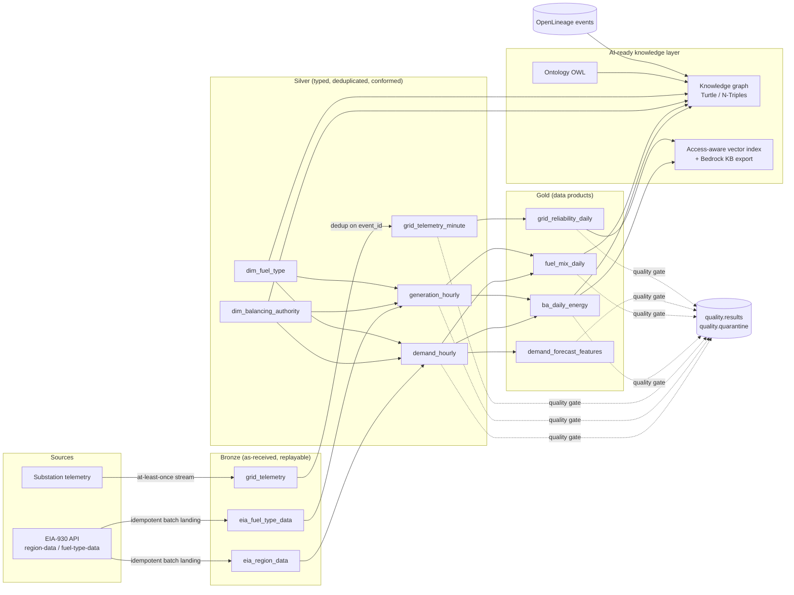
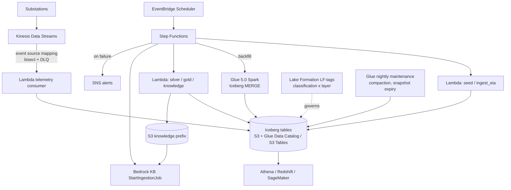

# Architecture

## Context

US balancing authorities (BAs) publish hourly demand, day-ahead forecasts, net generation
and interchange through EIA-930, and every substation streams frequency/load telemetry.
Downstream consumers want very different things from the same raw data:

| Consumer | Needs | Served by |
|---|---|---|
| BI / sustainability reporting | daily demand, peak, renewable share, carbon intensity | `gold.ba_daily_energy`, `gold.fuel_mix_daily` |
| ML (SageMaker) demand forecasting | leakage-free hourly features | `gold.demand_forecast_features` |
| Reliability engineering | frequency excursions (confidential) | `gold.grid_reliability_daily` |
| AI agents / RAG assistants | vocabulary, relationships, citeable facts, access control | ontology + knowledge graph + vector index, grid analyst agent (`src/gridlake/agent`) |

## Logical flow

## AWS deployment

| Concern | Local | AWS |
|---|---|---|
| Table format | Apache Iceberg v2 (pyiceberg) | Apache Iceberg v2 |
| Catalog | SQLite-backed Iceberg SQL catalog | AWS Glue Data Catalog, or Amazon S3 Tables (Iceberg REST) |
| Compute | DuckDB in-process SQL | Lambda (incremental), Glue Spark (backfill) |
| Streaming | File-backed partitioned log + offset store | Kinesis Data Streams + Lambda event source mapping |
| Orchestration | `Pipeline.run()` | Step Functions, one task per `gridlake step` |
| Governance | contract classification + clearance filter | Lake Formation tag-based access control from the same contracts |
| Lineage | OpenLineage JSONL | OpenLineage HTTP (Marquez, DataZone / SageMaker Catalog) |
| Knowledge base | Hashed TF-IDF index | Amazon Bedrock Knowledge Base (S3 data source + metadata filters) |
| Grid analyst agent | `gridlake ask`: offline planner (or Claude on Bedrock), DuckDB SQL tool | Bedrock Agent + tools Lambda, Athena workgroup, Bedrock KB `Retrieve` with a classification filter |

Switching is configuration only: `GRIDLAKE_CATALOG=glue|s3tables`, `GRIDLAKE_WAREHOUSE`, `GRIDLAKE_S3_TABLES_ARN`.

## Key mechanisms

### Data contracts are the control plane
`contracts/*.yaml` declares schema, primary key, partitioning, owner, classification,
consumers, business terms and quality rules for each table. One file drives:
Iceberg DDL and identifier fields, schema-on-write casting, quality gates, Glue tables
and Lake Formation tags (Terraform `yamldecode`s the same files), lineage facets,
catalog documents for RAG, and the knowledge graph's data-estate half.

### Incremental and idempotent by construction
* **Bronze** batches are content-addressed (`_batch_id`); a replayed extract is skipped.
* **Silver** keeps a high-water mark (Iceberg table property) per source. Only new bronze
  rows are read; the business keys they touch are recomputed from full history so EIA
  restatements resolve to the latest value, then MERGEd on the primary key.
* **Gold** recomputes affected dates only and writes with a dynamic partition overwrite.
  Feature tables extend the window by 7 days because lags propagate forward.

### Streaming: at-least-once in, exactly-once out
Offsets are committed only after the Iceberg commit succeeds (a crash replays the batch).
Silver deduplicates on `event_id`. A per-partition event-time watermark (min across
partitions minus allowed lateness) flags late events; they are kept in bronze and folded
in by `--reconcile` rather than silently dropped.

### Quality gates
Row-level rule failures are quarantined with the failing rule names; dataset-level failures
(row counts, freshness) and anything failing in a gold table raise `QualityGateError`,
which fails the step, emits an OpenLineage `FAIL` event, and stops publication. Every
evaluation is persisted to `quality.results`.

### Knowledge layer for agents
* **Ontology** (`ontology.yaml` → OWL Turtle) names the classes and relationships agents may
  use. The graph builder validates every triple's domain and range, so a wrong relationship
  fails the build rather than reaching an agent.
* **Knowledge graph** joins grid topology (BA → region → interconnection, generation mix)
  with the data estate (dataset → columns → business terms, owner, classification,
  `derivedFrom` lineage). Exported as N-Triples for Amazon Neptune bulk load.
* **Retrieval** enforces the caller's clearance before ranking, so confidential telemetry
  can never enter a prompt for a `public` caller. The same documents and metadata export
  as an Amazon Bedrock Knowledge Base data source.
* **Context packs** (`gridlake ask`) link entities by label/code/alias, add graph facts and
  filtered passages, and return a citeable prompt.
